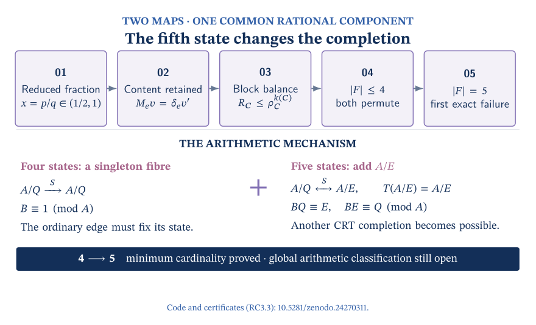

# Primitive Radix–Möbius Dynamics · RGΦ

## Current Tarasutra continuation — 19 November 2026

119772/factor 2 (0003/S) is explicitly realized. The independent checker
verifies five primitive states, ten edges and the complete CRT base fibre.
The current ledger is 37 excluded / 2 realized-containing / 1 existence-open.
Only 606897/factor 3 (0007/T) remains existence-open.
Run make tarasutra-verify. [Evidence](research/rc33/tarasutra/RESULTS.md).
Current public register:119 records, including65 continuation records.
Private manuscripts are synchronized separately; manuscript HTML is not rebuilt.
Uniqueness within realized types and the global minimum-base problems remain open.
Earlier dated counts below are historical. Original DOI/tag unchanged.


## Current compiled continuation · FST16 and causal traces

The three prior causal results are now incorporated into the six private PDF/HTML manuscripts. Three FST16 records add a3-adic isometry, coprime prefix/suffix inversion and exact DFA-cylinder pruning, with reconstructed10000-digit counts3944/986/110/2/1. The value/key precision shift and general-prime contractions are explicit. Current public ledger:116 records;62 continuation cards. [FST16 evidence](research/rc33/fst16/RESULTS.md) · [Causal evidence](research/rc33/causal-traces/RESULTS.md). Original FST15/16 software was not supplied; independent reconstruction is distinguished from its missing suites. Private sources remain embargoed; the original DOI/tag is unchanged. Earlier dated pending-document paragraphs are historical checkpoints superseded here.

## Causal trace continuation · 17 November2026

Three new scoped research records transfer XI–XIII to the actual RGΦ witness: based-loop trace rank2 and an explicit blind pair; four admissible suffix probes of length at most2 for the whole known CRT family; and fixed-point-trace Hankel rank11 with30 future-trace classes among36 actions. [Proofs and contracts](research/rc33/causal-traces/RESULTS.md) · [Origin return](research/rc33/causal-traces/RETURN_XI_XIII_ES.md). Independent exact ECMAScript replay covers the2,097,151 binary and265,720 ternary histories and Apéry–CRT data. Run make causal-trace-verify.

Current public counts:113 claim records and59 continuation records. The previous private PDF/HTML project was unavailable; its56-card continuation and PDF hashes remain the last compiled delivery. [Private integration destinations are pending](research/rc33/causal-traces/INTEGRATION_STATUS.json). No rebuilt manuscripts, full Python aggregate rerun, source browser tests or remote CI certification are claimed. The two existence rows, uniqueness and least-base gates remain open; original DOI/tag unchanged.

## Current phase, atom and arithmetic-index integration

[Seven new scoped records](research/rc33/sine-assault/RESULTS.md) bring the continuation to56 cards. The fifteen words and1922-endpoint sine partition are now reconstructed exactly. Whole-token affine observers have an explicit dual-anchor inverse. In the five residual arithmetic chambers, each fixed completion index has finitely many primitive carriers with H<(200lambda)^10; the global envelope is H^41<6400^10(B^2-1)^10 without requiring prime E. All indices<=5 are excluded at every coordinate height (factor two requires index>=7). A uniform index bound is still open; all-cardinality minimum-base control is a separate gate. Run `make sine-assault-verify`. Earlier missing-data statements remain dated historical checkpoints. No full manuscripts are published, and the original DOI/tag is unchanged.

**Scientific edition RC3.3 · integrated continuation: 17 November 2026**

Public software, exact certificates and research records for *Finite Rational Components in Primitive Radix–Möbius Dynamics: Content and a Sharp Threshold*, by Facundo Firmenich.



## Results and current scope

| Result | Evidence |
| --- | --- |
| Both maps permute every finite high component with at most four states; five states attain the first failure | [Threshold proof](proofs/SHARP_THRESHOLD.md) · [CRT witness](certificates/ARITHMETIC_PROGRESSION.json) |
| Complete forty-case oriented ledger: **37 exclusions / 2 realized-containing rows / 1 existence-open row** | [Oriented ledger](research/five-state/continuation/ORIENTED_STATUS.csv) |
| All-height certificates on specified cofactor strata, including h ≤ 14, and fifth-coordinate restrictions | [RC3.3 checkers](research/rc33/README.md) |
| Exact chamber reduction for 606897/3; saved exhaustive t ≤ 5000 exclusion with current prefix and terminal replay | [Recent result register](research/rc33/recent/RESULTS.md#r17b) |
| Weighted and coupled finite-group covers, deterministic phases and finite recovery records | [Recent modules](research/rc33/recent/RESULTS.md) · [24 claim cards](research/rc33/recent/CLAIMS.json) |

One existence orientation, uniqueness within each realized type and least-base questions remain open. The [live research dashboard](RESEARCH_STATUS.md) distinguishes these questions from proven finite and conditional statements.

The **FST-11 continuation** adds [five word-observation claims](research/rc33/fst11/RESULTS.md): complete variable-length forms, complementary normalization channels, language-conditioned CRT and a nonregular global fibre. It includes the unchanged received engine and an exact cross-checker.

The **T007 sister-branch continuation** adds [seven scoped records](research/rc33/t007/RESULTS.md): a Q≤5000 six-state hexagon certificate, exact word-tower separation, a checked transfer boundary and a 43-prime elliptic relation sieve with a 172-fold norm improvement.

## Reproduce

```bash
python -m pip install -e '.[dev]'
make reproduce
```

This runs the core verifier, tests, RC3.3 certificate checks, ten recent replay scripts the FST-11 suite and the T007 checks; rebuilds traceability, figures and graphs; audits synchronization; and seals the generated outputs. The expensive complete t ≤ 5000 census is separately available as `make recent-full-census`; the default replay verifies its saved code hash, finite prefix and all 157 terminal candidates.

See the [quick start](QUICKSTART_REPRODUCE.md), [verification guide](VERIFICATION.md), [current replay receipt](outputs/reports/recent/RUN_MANIFEST.json) and [synchronization record](docs/SYNC_2026-11-17.md). GitHub Actions runs only by manual dispatch.

## Figures and HTML

- Standalone maps and visual abstracts: [English viewer](outputs/interactive/rc33_epistemic_EN.html) · [Spanish viewer](outputs/interactive/rc33_epistemic_ES.html).
- Searchable [interactive dependency graph](outputs/interactive/epistemic_graph.html) and its [JSON data](outputs/interactive/epistemic_graph.json).
- [Claim traceability](outputs/reports/claim_traceability.md) and [canonical alignment hashes](metadata/CANONICAL_ALIGNMENT.json).

GitHub's file viewer shows HTML source; download the repository and open the HTML files locally for the rendered interactive editions. [Resumen en castellano](README_ES.md).

## Citation and archive

The registered version DOI is [10.5281/zenodo.24270311](https://doi.org/10.5281/zenodo.24270311); the all-versions DOI is [10.5281/zenodo.24270310](https://doi.org/10.5281/zenodo.24270310). It identifies the immutable 16 November code snapshot tagged [`rc3.3-zenodo`](https://github.com/FacundoFirmenich/primitive-radix-mobius-dynamics/releases/tag/rc3.3-zenodo), commit `7d94e81d06944f36640ab289b87473fc0292c6df`.

Current `main` adds the 17 November integration. This continuation has not been archived under a new DOI; the existing tags and archive remain unchanged. Scientific edition RC3.3 is retained; the installable package version is 0.3.3. See [CITATION.cff](CITATION.cff).

The [pre-arXiv publication boundary](docs/PUBLICATION_BOUNDARY.md) remains active: this repository contains code, certificates, metadata and standalone figures. Complete main, supplementary and companion manuscripts remain in the private A1 delivery. Code is MIT and research records are CC BY 4.0 under the [licensing terms](LICENSE.md).

The **FST12/13 continuation** adds [nine scoped records](research/rc33/fst1213/RESULTS.md) on language complexity, natural boundaries, erasure families, bounded inverse ranks and effective modular resolution. Run `make fst1213-verify`; the two received atlas scripts are replayed in Node with an inert DOM, separately from the new exact Python checks.

### FST14 terminal-inverse continuation

Four scoped records and a reproducible declared-adapter audit extend FST12/13: exact terminal periods, bounded lifting/CRT inversion and logarithmic suffix resolution. Run `make fst14-verify`. The missing historical baselines and browser suites are not represented as replayed. Current combined continuation:49 cards;103 public claim records. Full manuscripts remain private; original DOI/tag unchanged.
