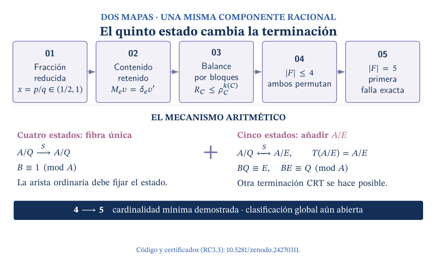

# Primitive Radix–Möbius Dynamics · RGΦ

**Edición científica RC3.3 · integración del 17 de noviembre de 2026**

Software, certificados exactos y registros de investigación de Facundo Firmenich.



El registro orientado comprende **37 exclusiones, una fila que contiene una realización y dos filas abiertas**. Se incorporan los cinco módulos recientes: transferencia seno–π, sinergias estructurales, cámara de 606897/3, recubrimientos ponderados y extensión ternaria. Las 24 afirmaciones añadidas tienen dependencias y evidencias explícitas. La continuación FST-11 añade cinco afirmaciones sobre palabras de longitud variable, canales complementarios, recuperación condicionada por lenguajes y una fibra global no regular; véase `research/rc33/fst11/RESULTS.md`.

```bash
python -m pip install -e '.[dev]'
make reproduce
```

El replay comprueba los programas, el prefijo del censo y sus 157 candidatos terminales. El censo completo guardado hasta t = 5000 no se presenta como una nueva ejecución completa; puede repetirse por separado con `make recent-full-census`. La existencia global de las dos orientaciones, la unicidad irrestricta del portador conocido y las bases mínimas siguen abiertas.

[Registro de resultados](research/rc33/recent/RESULTS.md) · [Estado científico](RESEARCH_STATUS.md) · [Registro de sincronización](docs/SYNC_2026-11-17.md) · [HTML en castellano](outputs/interactive/rc33_epistemic_ES.html) · [Grafo interactivo](outputs/interactive/epistemic_graph.html).

Para visualizar los HTML, descargar el repositorio y abrirlos localmente. Los manuscritos completos permanecen en la entrega privada A1 conforme al embargo pre-arXiv. El DOI [10.5281/zenodo.24270311](https://doi.org/10.5281/zenodo.24270311) identifica el archivo inmutable del 16 de noviembre; esta continuación de `main` conserva RC3.3 y no cambia aquel archivo. [Documentación principal en inglés](README.md).

La continuación T007 incorpora el hexágono de seis estados hasta Q≤5000, la separación uniforme de la torre de Fronteras y el tamiz elíptico de 43 primos con mejora exacta de norma por un factor 172. Los destinos y alcances están separados en `research/rc33/t007/RESULTS.md`.

La continuación **FST12/13** añade [nueve tarjetas](research/rc33/fst1213/RESULTS.md): complejidad de lenguajes y frontera natural, familias de borrados, inversión con longitud acotada y resolución modular efectiva. Se preserva la atribución previa de multiplicidades y entropía. `make fst1213-verify` ejecuta los scripts de ambos atlas y los controles enteros separados. Las cifras de las quince familias seno–π no se certifican sin sus definiciones originales.

### Continuación FST14: inversión terminal

Cuatro registros con alcance explícito: períodos exactos, inversión por elevación/CRT y resolución terminal logarítmica. `make fst14-verify` reproduce la auditoría bajo un adaptador declarado; no se atribuye ejecución a las suites históricas ausentes. Total actual:49 tarjetas de continuación y103 registros públicos. Los manuscritos completos permanecen privados; DOI y tag originales inalterados.
